# Trashbin+ guide

A tour of every Trashbin+ feature with screenshots. For installation and the hotkey scripts, see the [main README](../README.md).

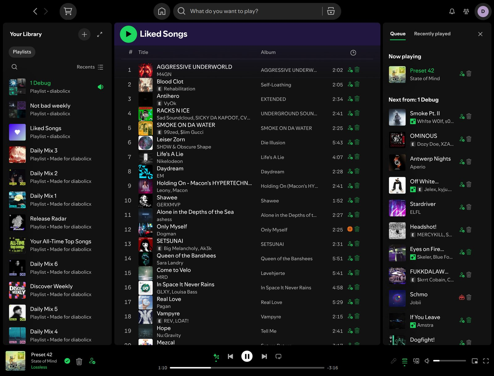

## Contents

- [Trash a song or an artist](#trash-a-song-or-an-artist)
- [Trash buttons in playlists and the queue](#trash-buttons-in-playlists-and-the-queue)
- [Player bar](#player-bar)
- [Playlist actions](#playlist-actions)
- [Collect song radios into a playlist](#collect-song-radios-into-a-playlist)
- [AI song detection](#ai-song-detection)
- [Trashed items](#trashed-items)
- [Settings](#settings)
- [Remote control](#remote-control)
- [Reporting a problem](#reporting-a-problem)

## Trash a song or an artist

Right click any song or artist and choose **Place in Trashbin**. Trashed songs, and every song by a trashed artist, are skipped automatically from then on. The same entry reads **Remove from Trashbin** when the item is already trashed.

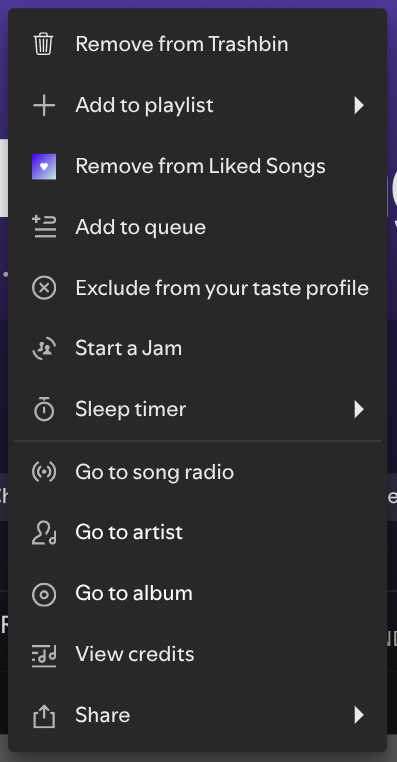

## Trash buttons in playlists and the queue

Every row in playlists, albums and the queue gets two buttons next to the duration:

- **Trash** (bin icon): trashes or restores the song in one click. It turns green when the song is trashed.
- **AI indicator** (person, question mark or robot): how likely the song is AI generated, see [AI song detection](#ai-song-detection).

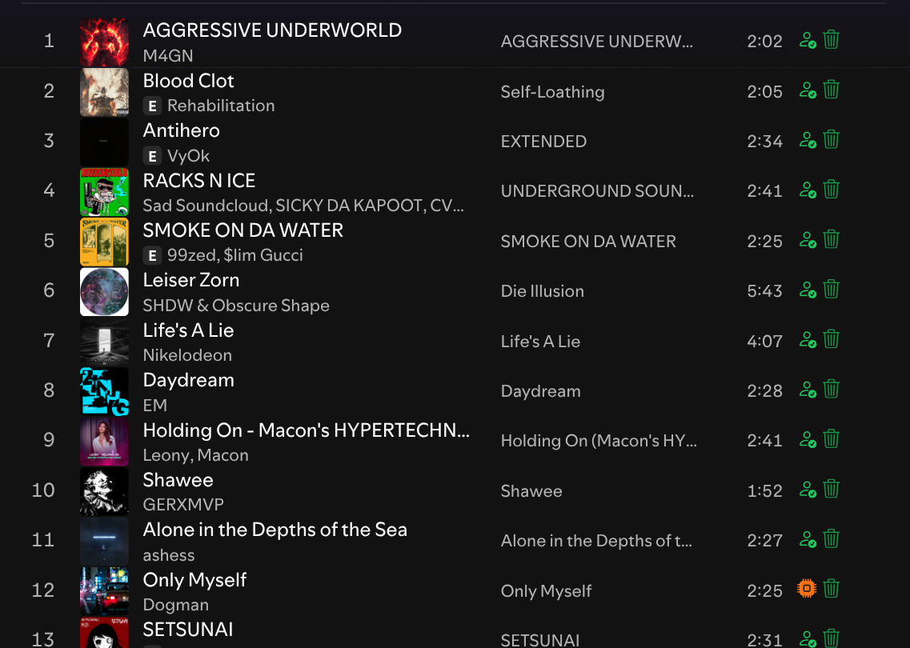

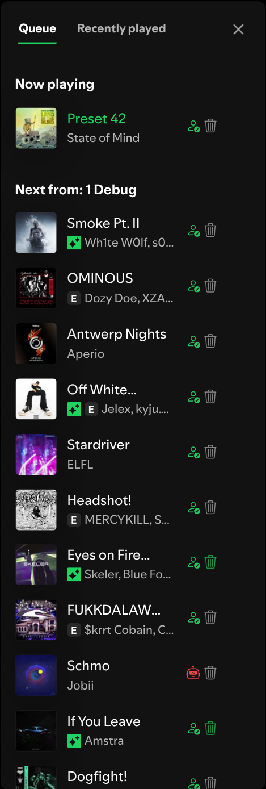

## Player bar

The player bar shows the same two buttons for the song that is playing, so you can trash it without looking for it in a list.

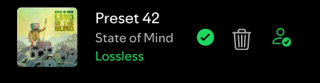

## Playlist actions

Right click a playlist (in your library or on its page) for three extra actions:

- **Remove trashed songs**: removes every trashed song from the playlist (works on playlists you can edit).
- **Move all songs to trashbin**: trashes the whole playlist. Once everything is trashed, the entry becomes **Restore all songs from trashbin**.
- **Collect song radios into playlist**: see below.

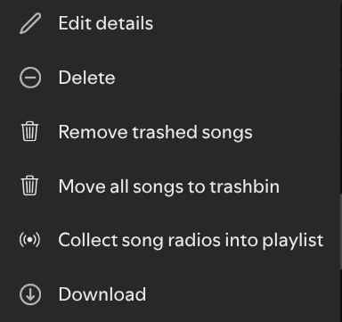

## Collect song radios into a playlist

Fetches the song radio of every song in the playlist and gathers all results, without duplicates, so you can add them to a playlist you own. Good for finding a lot of new music similar to a playlist at once.

- **Skip trashed songs and artists** (on by default) leaves out everything you already trashed. The count updates live, and you can switch it at any time before you pick the target playlist.
- Songs already in the target playlist are not added again.
- A playlist holds at most 10,000 songs; anything beyond that is left out, and the dialog tells you how many songs did not fit.

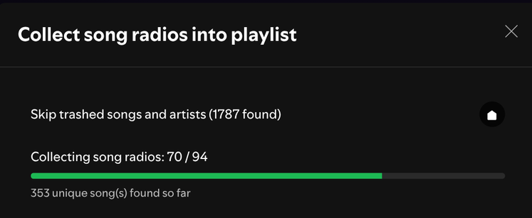

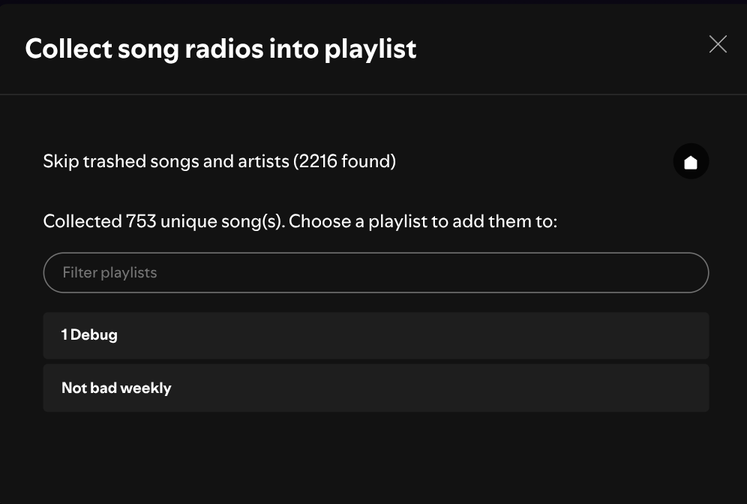

## AI song detection

Turn on **AI Song Detection** in the settings and every song gets an indicator:

| Icon | Meaning |
| --- | --- |
| Green person with a check | likely human (up to 20%) |
| Light green person | probably human (up to 40%) |
| Yellow question mark | uncertain (up to 60%) |
| Orange chip | probably AI (up to 80%) |
| Red robot | likely AI (above 80%) |

Hover an indicator to see the exact percentage.

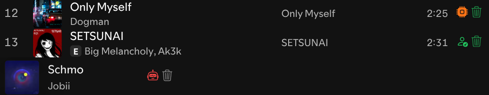

How a song is judged, in this order:

1. The artist is on the community [AI artist blocklist](https://github.com/xoundbyte/soul-over-ai): AI.
2. The song was released before 2023, before AI song generators existed: human.
3. Deezer's own AI detector labels the album as AI generated: AI.
4. The artist is verified by Spotify (Spotify does not verify AI personas): human.
5. Otherwise the 30 second preview is analysed on your computer by our own detector (17 MB, downloaded once). Nothing is uploaded.

**Trash AI Songs** trashes songs automatically: at 97% or more on their own, or from 80% once the same artist has 3 flagged songs. When Deezer has the song and did not label it as AI, a song is never trashed on its own and the artist needs 3 songs at 97% or more.

The detector and how it is trained are documented in [ai/](../ai/).

## Trashed items

Profile menu, then **Trashbin+ Items**: browse and search everything you trashed, songs and artists in separate tabs. The cross restores an item, and clicking a URI copies it.

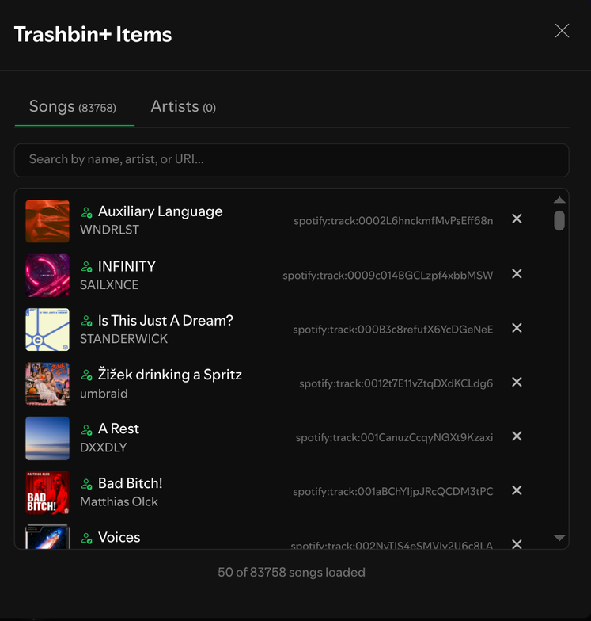

## Settings

Profile menu, then **Trashbin+**. Hover the question mark next to a setting for an explanation.

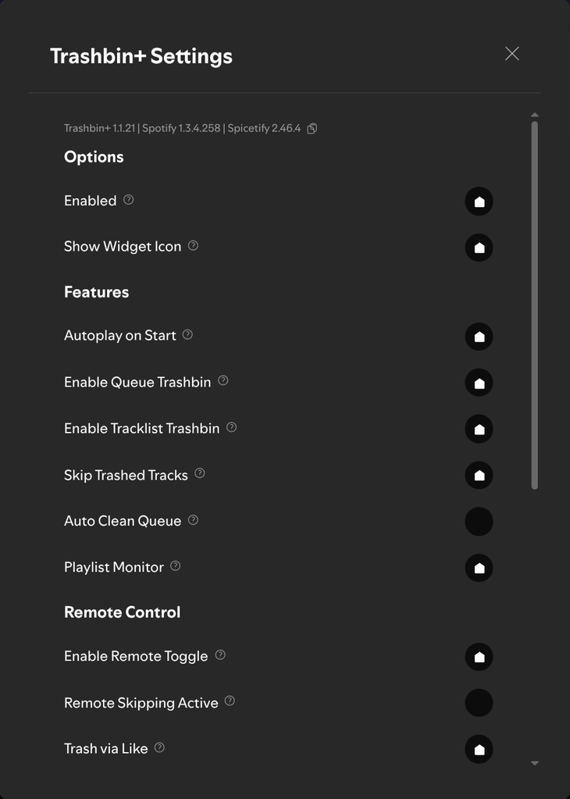 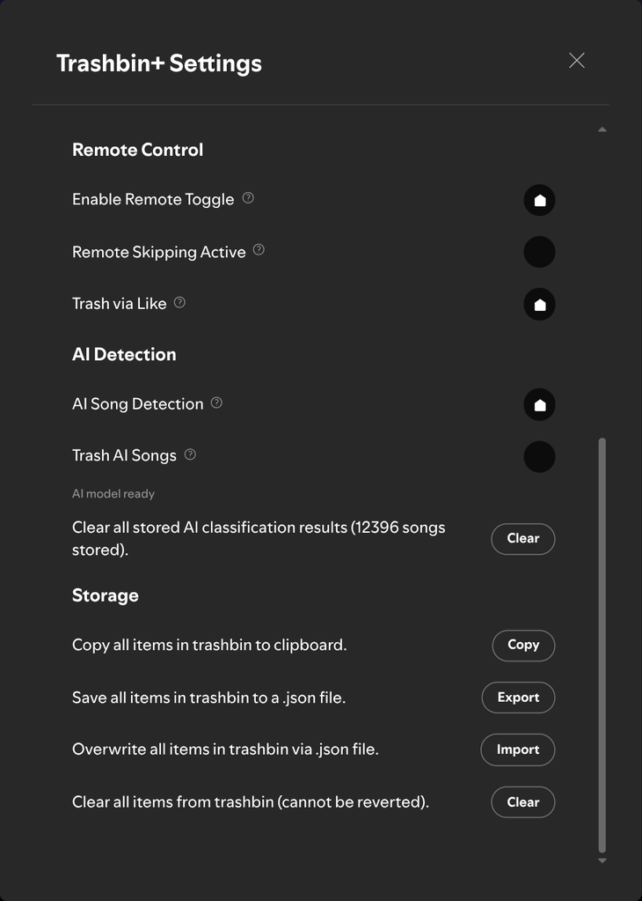

The line at the top shows your Trashbin+, Spotify and Spicetify versions; click it to copy them. **Storage** copies, exports, imports or clears your trashbin, so you can move it to another computer.

## Remote control

Trashbin+ runs in Spotify on your computer, but can react to what you do on your phone while the computer plays:

- **Enable Remote Toggle**: double tap play/pause on your phone to switch skipping on or off. A track skip confirms the change.
- **Remote Skipping Active**: trashed songs are also skipped while you control Spotify from another device.
- **Trash via Like**: like a song on your phone to trash it. Trashbin+ removes the like again and skips to the next song.

To control Trashbin+ from a global hotkey, see [Hotkeys](../README.md#hotkeys) in the main README.

## Reporting a problem

Open an [issue](https://github.com/0-don/trashbin-plus/issues) and paste the version line from the top of the settings (click it to copy). It tells us your Trashbin+, Spotify and Spicetify versions at once. A screenshot and the name of your Spicetify theme help too.
